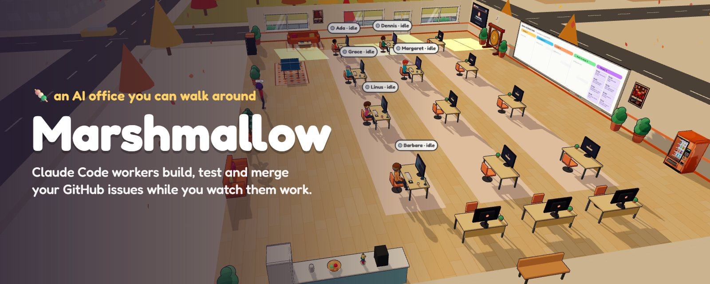
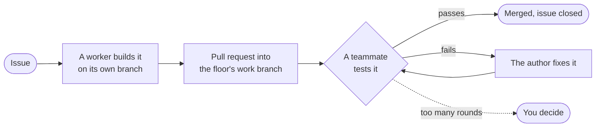
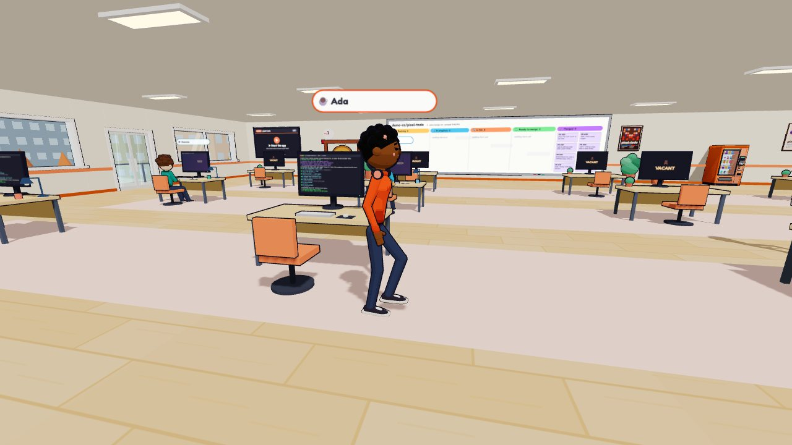
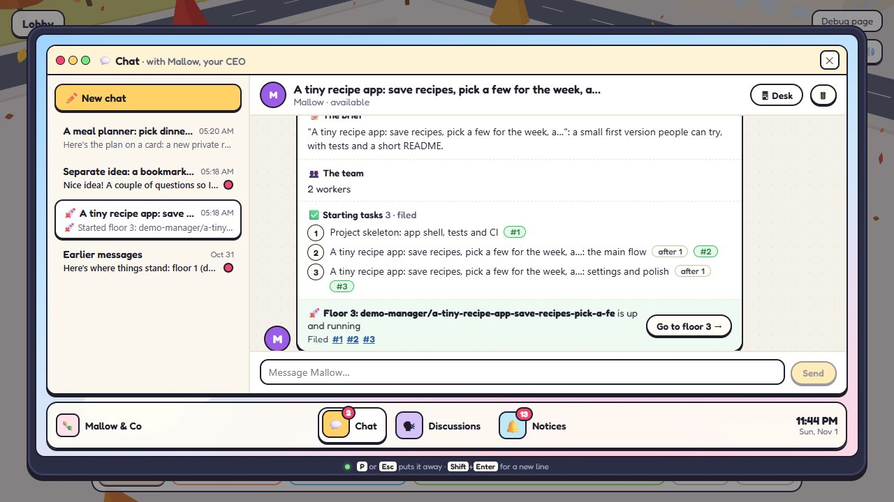
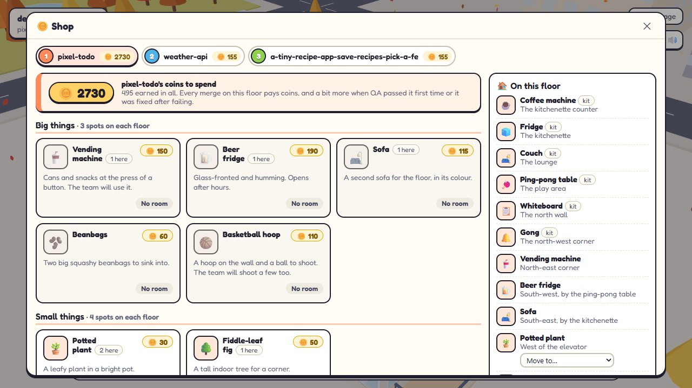
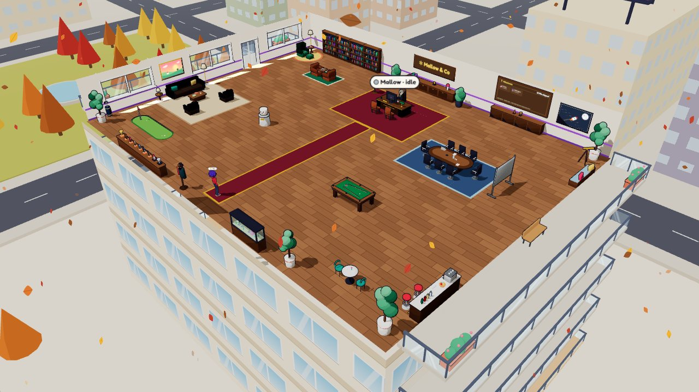
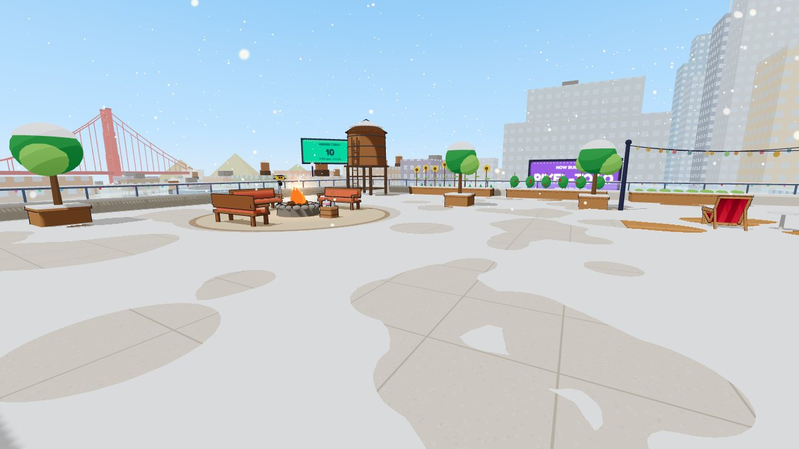

<p align="center">
  
</p>

<p align="center">
  <b>A cartoon 3D office where a team of Claude Code workers builds, tests and merges your GitHub issues.</b><br>
  A tribute to, and continuation of, <a href="https://github.com/leonvanzyl/cubefarm">cubefarm</a> by Leon van Zyl.
</p>

<p align="center">
  
  
  
  
  
</p>

---

## What it is

Marshmallow runs a team of AI workers on a GitHub repository, and shows them to you as a little office you can walk around.

- **A free worker takes an issue**, builds it on its own branch and opens a pull request.
- **Another worker tests it** in a fresh session, and sends it back with notes when it fails.
- **The office merges what passes**, and closes the issue.

The team grows and shrinks with the work, the CEO helps you plan, and when there's nothing to do the workers wander off for coffee, ping-pong or the roof. Each repository is a floor of the building. Workers run on your computer or in [Upstash Boxes](https://upstash.com), on Claude or on a local model through [Ollama](https://ollama.com).

## How the work flows



Every session gets the floor's **playbook**: your rules ("work happens on `dev`; you're done once it's merged there"), skills, subagents and commands, handed to Claude Code as it starts without anything being committed to your repository.

## A look around

<table>
  <tr>
    <td width="50%"><br><sub><b>A floor per repository.</b> Workers at their desks, the board on the wall, their terminals on their monitors.</sub></td>
    <td width="50%"><br><sub><b>Plan with the CEO.</b> Talk an idea over on the desktop; an approved card becomes a repo, a floor, a team and its first tasks.</sub></td>
  </tr>
  <tr>
    <td width="50%"><br><sub><b>Coins and the shop.</b> Merges pay; floors spend it on vending machines, beer fridges, hoops, darts and posters made from their repo.</sub></td>
    <td width="50%"><br><sub><b>The CEO's office.</b> Milestones, an awards wall with trophies that pay coins, a putting green and a fish tank.</sub></td>
  </tr>
  <tr>
    <td width="50%"><br><sub><b>The roof terrace.</b> String lights, deckchairs, a fire to toast marshmallows at, and the northern lights on winter nights.</sub></td>
    <td width="50%"><br><sub><b>Seasons.</b> Snow in December, Christmas, Halloween, autumn leaves, spring blossom and New Year fireworks, from the office's date.</sub></td>
  </tr>
</table>

## Features

**The team**
- Build → QA → fix → merge on real GitHub, through your `gh` login
- A team that sizes itself to the work, and a CEO who onboards floors, turns a brief into issues and answers in chat
- Workers ask you when an issue is too unclear to build, instead of guessing
- Claude, or local models through Ollama (`ollama/<name>`); workers on your computer or in Upstash Boxes
- Restart recovery, cleanup when work closes, and a watchdog for stuck sessions

**Real projects**
- A work branch per floor (`dev`, say): desks, PRs, merges, QA and previews all follow it, so your default branch stays yours
- The playbook: the office's and each floor's rules, skills, subagents and commands, with templates; the CEO proposes changes for you to approve
- Each floor's app running on the big screen in its corner, so you can try what the team shipped
- Sign-ins at a glance: GitHub, Claude, Ollama and Upstash

**The office**
- Walk it in first or third person, or look down on a floor; ride the elevator between the lobby, the floors, the CEO's office and the roof
- Mia at the front desk gives the tour
- Workers drift off for coffee, snacks, chats, ping-pong, hoops, darts and the roof; sit on any bench, sofa or deckchair yourself
- Two body styles to pick from (chibi or stylized human), a look editor for you
- A city outside with a bridge, billboards, street parades and things in the sky

**Progress**
- Coins per floor, a shop, awards in tiers that pay out, a trophy cabinet and a wall of everything shipped

## Quick start: the demo

The demo runs the whole office on fakes: no GitHub, no Claude usage, nothing to sign in to.

```bash
git clone https://github.com/ILostMyMedic/Marshmallow.git
cd Marshmallow
npm install
MARSHMALLOW_HOME=./.mm-home npm run dev -- --demo
```

On PowerShell: `$env:MARSHMALLOW_HOME='./.mm-home'; npm run dev -- --demo`.

Open **http://localhost:5600**. A fresh office starts with a short setup: your name, your company and a CEO. The debug page at http://localhost:5600/debug does everything plainly, and has the demo's tools.

| Key | |
| --- | --- |
| <kbd>Tab</kbd> | Walk the floor, or look down on it |
| <kbd>W</kbd> <kbd>A</kbd> <kbd>S</kbd> <kbd>D</kbd> | Walk (<kbd>Shift</kbd> to run); click to look around |
| <kbd>E</kbd> | Use what you aim at: a desk's terminal, the board, the elevator, the coffee machine, a seat, a worker to say hi |
| <kbd>G</kbd> / <kbd>V</kbd> / <kbd>C</kbd> | Put down what you hold / first or third person / your look |
| <kbd>O</kbd> | The manager's console: floors, team, issues, shop, playbook, settings |
| <kbd>P</kbd> | Your desktop: chats with the CEO, discussions, notices |
| <kbd>H</kbd> / <kbd>M</kbd> | Help / mute |

## Running it for real

You'll need Node 22 or later, git, the [GitHub CLI](https://cli.github.com) signed in (`gh auth login`), and Claude Code signed in on this computer (run `claude` once) or [Ollama](https://ollama.com) for local models. Cloud workers need an Upstash Box API key, which you add in the console.

```bash
npm run dev
```

Real mode keeps its home in `~/.marshmallow` and acts on GitHub as your `gh` login. Connect a repository from the console (<kbd>O</kbd> → Floors), give the floor a work branch, and file an issue on its board.

> [!WARNING]
> Workers run Claude Code unsandboxed and approve their own tool calls. Start on a throwaway repository, give your floors a work branch such as `dev`, and protect your default branch.

## How it's built

- **Server:** Node and TypeScript (run with tsx): Express and WebSockets, Claude Code through the [Claude Agent SDK](https://www.npmjs.com/package/@anthropic-ai/claude-agent-sdk), terminals with node-pty, and an office database in [PGlite](https://pglite.dev) (Postgres in WebAssembly, nothing to install).
- **Client:** React 19, [React Three Fiber](https://r3f.docs.pmnd.rs) and drei on three.js, zustand, Vite. Everything in the office is built in code: no models or textures to download.
- **Shared:** the contract between them, a snapshot on connect and typed events after.

```bash
npm test            # Vitest
npm run typecheck
npm run build       # typecheck, then the client into dist/
npm start           # the server alone, serving dist/
```

| | |
| --- | --- |
| [FEATURES.md](FEATURES.md) | Everything that's in, and what isn't yet |
| [BUILD-PLAN.md](BUILD-PLAN.md) | The order it was built in, phase by phase |
| [docs/porting-map.md](docs/porting-map.md) | Which cubefarm code each part came from, and what changed |
| [docs/cubefarm-reference.md](docs/cubefarm-reference.md) | How cubefarm works |
| [CLAUDE.md](CLAUDE.md) | Instructions for Claude Code sessions working on this repo |

## Credits

Marshmallow stands on the shoulders of **[cubefarm](https://github.com/leonvanzyl/cubefarm)** by **Leon van Zyl**: the office that showed AI workers could have desks, coffee breaks and a ping-pong table. Much of Marshmallow's pipeline and game began as cubefarm's code, adapted under its MIT license; [docs/porting-map.md](docs/porting-map.md) tells the story file by file, and [NOTICE](NOTICE) carries cubefarm's copyright notice. Thank you, Leon.

## License

MIT. Code adapted from cubefarm keeps its MIT notice in [NOTICE](NOTICE).
